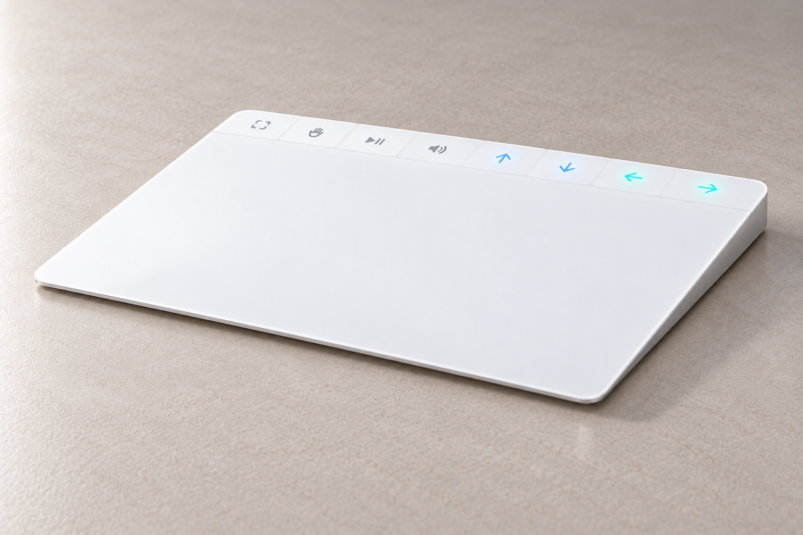
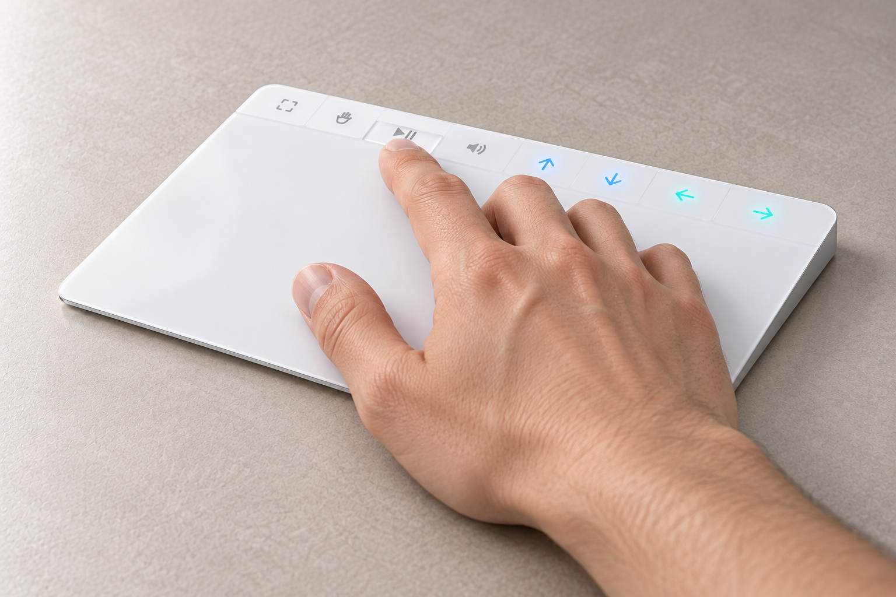
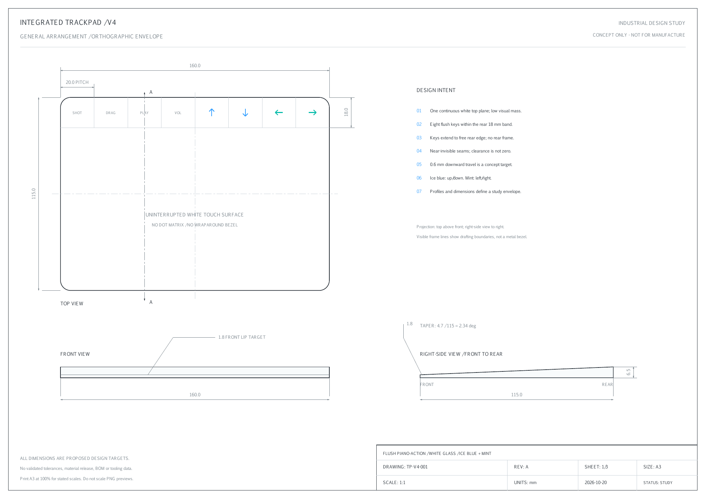
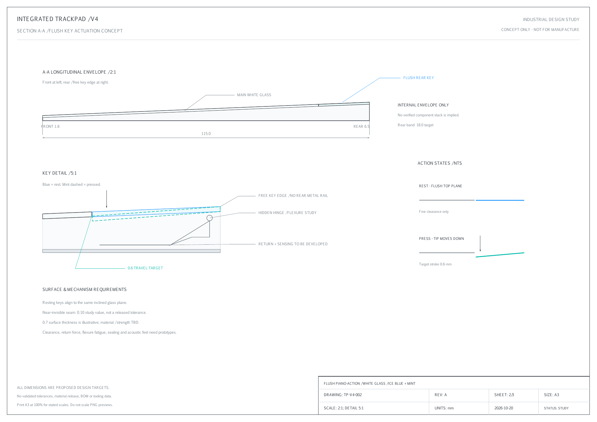
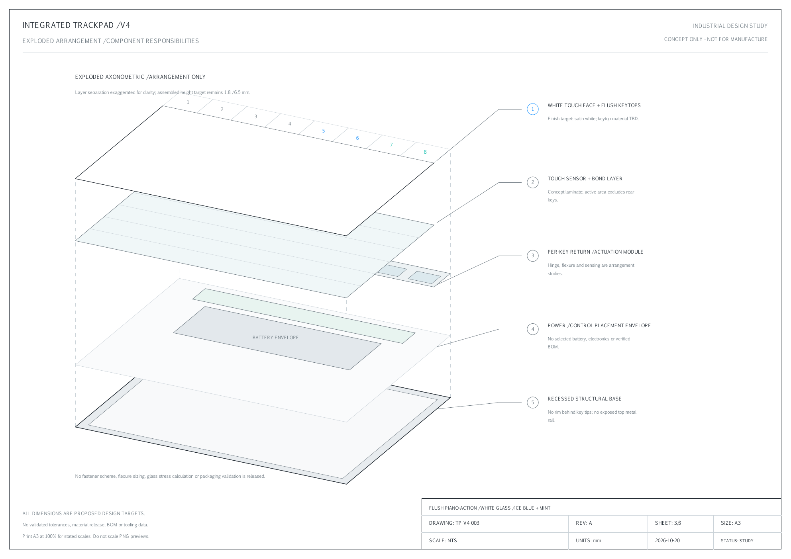

# 触摸板与Touch Bar一体化硬件概念

这是一套独立的硬件概念：把触摸板和可编程实体键放在同一块面板上。

我们想保留常见白色触摸板干净完整的外形，不额外堆一排键盘，不把整个面板加高。**前薄后厚的楔形，上方是几乎齐平的实体键。** 手正常放在触摸面上，食指前伸即可按到；按键像钢琴键一样下压回弹，而不是仅仅在玻璃上画按钮。

## 外形原则

- 一整块乳白视觉表面；中央留白，不铺密集点阵。
- 顶部键直接延伸到自由外沿，不在后方包一圈金属边框。
- 平时键顶齐平，分缝尽量不显眼；真实活动件仍需保留合理运动间隙。
- 上下冰蓝、左右薄荷青，光从材质下透出，避免抢眼的RGB灯带。
- 设想按键可自定义截图、拖移、播放暂停、音量及组合快捷键。**这是硬件及后续软件设想，现有软件没有任意快捷键编辑器。**

## 统一概念尺寸

| 参数 | 讨论目标 |
|---|---|
| 外形 | 160×115mm |
| 前沿 / 后端 | 1.8mm / 6.5mm |
| 顶部键区深度 | 18mm |
| 按键数量 / 节距 | 8键 / 20mm |
| 下压行程 | 0.6mm |

这些数值是概念设计目标，不是测量到的成品参数。效果图可能存在生成误差；参数化矢量包络与JSON才是本组图纸讨论尺寸的依据。

[下载A3矢量图册](industrial-design-A3.pdf) · [参数JSON](hardware-concept-spec.json) · [绘图脚本](hardware-draw_concept.py) · [效果图提示词](hardware-image-prompts.json)

三视图、前后厚度与剖切位置经过统一整理；机制图和分解图是结构职责示意。尚未完成公差链、玻璃/键帽材料选择、强度、回弹力、疲劳、器件堆叠、防尘和量产验证，不能作为直接加工依据。欢迎工业设计、机构与电子工程伙伴提出可验证的小样方案。

## 关于Apple

本项目与Apple无关。这套概念不代表Apple的产品计划，也尚未完成硬件原型。
