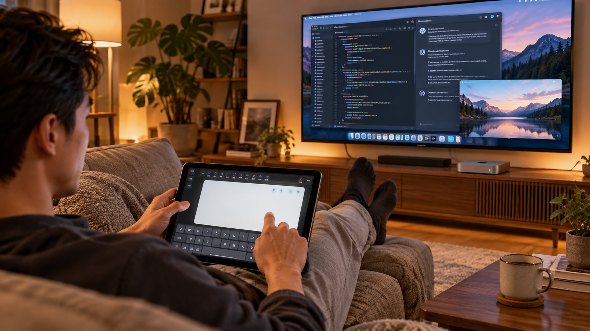
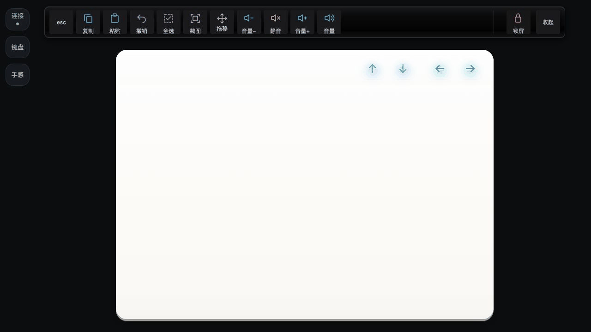
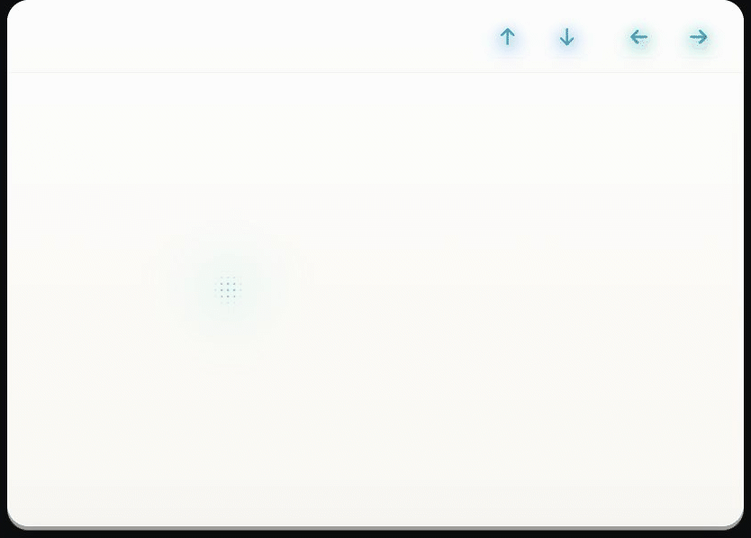

<div align="center">

# SofaPad

把闲置平板变成Mac的触摸板、键盘和Touch Bar。

[English](README.en.md) · [开始使用](#开始使用) · [全部手势](GESTURES.md) · [设备兼容性](COMPATIBILITY.md) · [硬件构想](HARDWARE.md) · [构建与贡献](DEVELOPMENT.md)

</div>



*AI生成的使用场景示意：电视是Mac mini的屏幕；平板把触摸板、系统键盘与快捷操作放在手边。不是实机测试照片。*

> **完整源码已开放下载**：[获取可构建的完整源码目录](SofaPad-0.4.17-public-source.zip?raw=1)。当前网页展示文档、媒体与安装包；源码包内包含Android、Mac接收端、测试、构建工作流与硬件绘图源文件。

## 这是什么

SofaPad让手机或平板控制Mac：滑动屏幕移动鼠标，双指滚动，用系统键盘打字，再用顶部的Touch Bar调音量、截图和执行快捷操作。

适合Mac mini接电视的场景。坐在沙发上，一块平板就能操作电脑、看剧，也能用来vibe coding。MacBook和其他Mac也可以使用。

Android设备可以安装APK，选择局域网或蓝牙连接。iPhone、iPad直接用浏览器，暂时没有原生iOS App。局域网模式需要在Mac运行接收端。

当前版本为 **0.4.17测试版**。项目实现常用鼠标、键盘和手势操作，不支持Apple私有触摸板协议、Force Touch压感或Taptic触感。

## 软件界面



*实际界面的离线演示，展示触摸板、键盘、手感设置、连接和音量面板。使用模拟连接，不代表实机延迟。*



*点阵涟漪：实际渲染器的逐帧演示。使用模拟触点，展示光点随触摸扩散和淡出。*


- **乳白触摸面**：外部区域保留黑色，平板按接近实体触摸板的比例排布；手机优先扩大可用触摸区。
- **冰蓝薄荷方向键**：↑↓一组，←→靠最右分组拉开，点按不混进鼠标触点。
- **顶部Touch Bar**：Esc、复制、粘贴、撤销、全选、截图、一次性拖移、音量、静音、锁屏。
- **左侧轻量入口**：连接、键盘、手感。平时把大部分空间留给触摸。
- **两套连接路径**：Android APK支持局域网与标准蓝牙HID；网页走局域网。
- **记住配对**：同一地址下再次打开可自动尝试连接；断线清理旧触点，锁屏或后台返回后重连。

## 开始使用

### 1. Mac准备接收端

下载并解压 [Mac接收端包](SofaPad-Mac-0.4.17.zip?raw=1)，把文件夹放在固定位置，双击里面的 **触摸板.app**。这是带图标的本地启动入口，会打开终端运行Python接收端，并显示配对页。

Mac需要Python 3，无需额外安装pip依赖。未安装Python时，按[安装说明](GETTING_STARTED.md)准备。

首次在 **系统设置 → 隐私与安全性 → 辅助功能**，允许实际启动接收端的终端或应用控制电脑，然后重启接收端。没有这项权限，网页可能显示连接成功，Mac却不会响应输入。

### 2. 旧平板或手机连接

| 设备 | 使用方式 |
|---|---|
| Android/兼容Android应用的平板 | 下载 [APK测试包](SofaPad-0.4.17-test.apk?raw=1)，打开“连接 → 扫码连接Mac”，直接在APK内扫码 |
| iPhone、iPad | 用系统相机扫描Mac配对页二维码，在Safari打开；没有iOS安装包 |
| 其他有触摸浏览器的设备 | 在同一可互通网络下访问Mac的配对入口；需要JavaScript、WebSocket及可用触摸事件 |

网页和APK局域网使用同一个配对二维码。首次确认后记住设备；同时只允许一台设备实际控制，另一台等待。

**目前局域网是HTTP/WS明文IP直连，无需安装证书。只在可信私网使用，不要通过它输入敏感密码。** [网络与隐私说明](SECURITY.md)

### 3. 开始摸、划、输入

- 单指移动，轻点点击，双击打开文件；双击第二下按住移动可拖拽。
- 双指轻点右键，双指上下/左右滚动，快速划动后可延续惯性。
- 想打字时点左侧“键盘”，使用设备的系统输入法；中文优先使用局域网模式。
- 三指/四指、捏合、截图选区等操作见下面的手势速查。

Mac换Wi-Fi后IP可能改变：在Mac刷新二维码，重新扫码更新地址。旧地址无法连接时，需要重新扫码。

## 手势速查

| 手势 / 操作 | 网页与APK局域网 | APK蓝牙 |
|---|---|---|
| 单指移动 | 移动Mac指针，支持多屏坐标处理 | 标准HID相对鼠标移动 |
| 单指轻点 | 左键点击 | 左键点击 |
| 连续轻点两次 | 双击，按目标应用处理打开/选词等 | 同类双击操作 |
| 双击第二下按住并移动 | 左键拖移；抬指释放 | 左键拖移；抬指释放 |
| 单指长按 | 默认不绑定右键 | 默认不绑定右键 |
| 双指短促轻点 | 右键；两指要有明显间距且近乎同时落下 | 右键 |
| 双指上下 / 左右划动 | 纵向 / 横向滚动，带方向意图识别 | HID滚轮与水平滚轮 |
| 双指快速划动后抬手 | 惯性滚动；新触点可打断 | 惯性滚轮输出；手感受系统与应用影响 |
| 双指捏合 / 张开 | 连续magnify事件；需要Mac应用支持，macOS兼容性待实测 | 用Command加减键做分级缩放兼容，非连续原生捏合 |
| 三指或四指横向划动 | 发送Control+方向键切换桌面/全屏空间 | 同类系统快捷键 |
| 三指或四指向上划 | Control+↑，通常为Mission Control | 同类系统快捷键 |
| 三指或四指向下划 | Control+↓，通常为当前应用窗口 | 同类系统快捷键 |
| 四指收拢 | 打开应用启动入口，随macOS适配 | Command+Space兼容路径 |
| 四指张开 | 显示桌面 | F11兼容路径 |
| 三指 / 四指原地轻点 | 默认不作为独立功能使用 | 不发送点击 |
| 从右侧预留边缘双指向左划 | 可选的Mac通知中心快捷键 | 可选的同类快捷键 |
| 点Bar“截图”，随后单指拖选 | Command+Shift+4，并准备一次性选区拖移 | 同类截图与选区路径 |
| 点Bar“拖移”，随后单指移动 | 一次性左键拖移，抬手结束 | 同类一次性拖移 |
| 可选拖拽锁定 | 默认关闭；启用后再次轻点结束，闲置超时释放 | 同类可选行为 |

**手势并非全部原生跟手动画。** 三四指操作主要转换为系统快捷键，其效果依赖Mac快捷键设置；普通三四指轻点不等于系统手势。右边缘手势需要先设置通知中心快捷键并启用。[完整手势说明、设置方法与限制](GESTURES.md)

## 两种连接，怎么选？

| | 局域网 / 浏览器 | Android APK蓝牙 |
|---|---|---|
| Mac端 | 需要本项目Python接收端与辅助功能权限 | 标准HID输入路径通常不依赖本项目接收端 |
| 设备 | Android、iPhone、iPad及合适的触摸浏览器 | Android 9/API28起，仍取决于ROM是否开放HID Device能力 |
| 中文和Unicode | 通过Mac接收端提交文本 | 标准键位报告不能任意注入中文Unicode |
| 缩放 | 连续事件适配，仍取决于目标应用与macOS版本 | 快捷键兼容缩放 |
| 自动连接 | 已记住设备会重试；IP变化需重扫 | 受系统配对、HID注册与ROM行为影响，仍需真机验证 |
| 网络 | 当前HTTP/WS明文，仅可信私网 | 标准蓝牙配对链路，能力不等于Apple私有触控板协议 |

中文输入建议用局域网。蓝牙省去Mac接收端，但输入和缩放能力有限；两种方式的手感都受设备、连接和Mac负载影响。

## Kindle等设备能不能用？

可以尝试，但目前没有Kindle实机适配结论。浏览器需要支持JavaScript、WebSocket和触摸事件；多指手势还需要设备上报多个触点。

Kindle电子墨水阅读器和Fire平板是不同平台。即使网页能打开，刷新速度和触控能力也可能不足以流畅使用。[设备兼容性](COMPATIBILITY.md)

## 硬件概念：触摸板与Touch Bar做在一起

除了软件，仓库也公开了一套硬件概念：乳白色触摸面，前薄后厚；顶部是一排可下压、回弹的实体键。键顶与触摸面齐平，分隔线尽量隐去，按压方式接近钢琴键。

顶部按键延伸到外沿，不加金属包边。冰蓝与薄荷青的背光从玻璃下透出，中央不铺密集点阵。设想每个键可自定义为截图、拖移、播放、音量或组合快捷键。

这套硬件尚未制作原型，图中结构和尺寸用于讨论。当前平板上的软件Bar提供预设快捷键，尚不支持任意自定义。

### 外观与自然按压


### 三视图、剖面与分解图


[A3矢量工业设计图册](industrial-design-A3.pdf) · [参数与绘图脚本](SofaPad-0.4.17-public-source.zip) · [硬件想法详解](HARDWARE.md)

这一版讨论目标是160×115mm、前1.8mm/后6.5mm、按键行程0.6mm。均为概念目标，尚未完成结构强度、器件堆叠、公差与寿命验证，不能直接拿去量产。

本项目与Apple无关，硬件图也不代表Apple的产品计划。Mac、Magic Trackpad、Touch Bar等商标归相应权利人。

## 版本与限制

当前提供0.4.17测试版APK、Mac接收端和完整源码。APK可覆盖安装本项目同签名旧版；云端构建使用独立的临时签名。

蓝牙自动重连、长时间闲置后的恢复、旧浏览器兼容及连续缩放，仍需要更多设备验证。三四指操作主要通过系统快捷键实现，不能获得原生触摸板的全部动画和手感。详见[兼容性说明](COMPATIBILITY.md)。

## 项目里有什么

```text
trackpad.py / trackpad_security.py / trackpad_power.py  Mac输入、配对与连接
android-apk/                                         Java原生壳、蓝牙HID、扫码、共享UI
触摸板.app / tools/                                  单一Mac图标入口与辅助脚本
docs/                                               上手、手势、兼容性、图文与演示
hardware/concept-v4/                                 工业设计PDF、参数和绘图源码
releases/0.4.17/                                     APK、Mac包和文件校验值
```

技术栈：**Python + Java + HTML/CSS/JavaScript**。日常使用不需要云账号，网页通过局域网与Mac接收端通信。

## 反馈与贡献

遇到问题可提交Issue，说明操作步骤、现象和连接方式。设备型号、系统版本等信息可自行选择是否提供；请勿附带设备名称、真实地址、配对二维码、令牌或输入内容。代码改进和硬件方案也欢迎讨论。

[开发与构建](DEVELOPMENT.md) · [贡献说明](CONTRIBUTING.md) · [隐私与网络边界](SECURITY.md) · [第三方许可](THIRD_PARTY_NOTICES.md)

项目原创代码以[MIT](LICENSE)发布；第三方组件保留各自许可。AI场景与硬件效果图、矢量概念图的制作方式及来源记录在[素材说明](MEDIA.md)。
